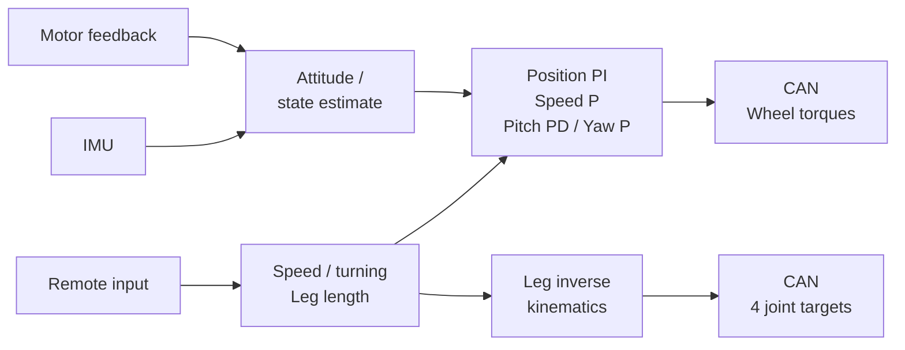

[简体中文](README.md) | [English](README.en.md)

# RoboBachelor

**Similar-linkage wheel legs · STM32 · PID balance control**

<p align="center">
  
</p>
<p align="center"><em>The physical prototype integrates its wheel-leg mechanisms, electronics and motor wiring on a compact chassis.</em></p>

RoboBachelor, originally named **SparkR**, is a compact two-wheeled legged robot. Its wheels provide rolling motion and balance, while the linkages on each side adjust the support geometry. This repository brings the mechanical models, STM32 firmware and documentation together so that the mechanism, wiring and controller can be explored as one system.

This release uses **PID-based control**: position PI, speed P, pitch PD and yaw-rate P. Leg inverse kinematics converts the requested support geometry into joint targets.

## Leg design: a compact similar-linkage mechanism

Two joint inputs per side control effective leg length and angle, with a wheel motor at the end of each leg. Gears and similar linkages transmit joint motion, concentrating the actuators beside the body instead of placing a motor at each successive leg joint.

- **Compact side packaging:** gears, links, drives and wiring fit around the small chassis while leaving room for leg motion.
- **Separate wheel and leg roles:** wheels provide rolling motion; the legs adjust support height and geometry.
- **A useful control representation:** effective leg length and angle describe wheel position, and inverse kinematics distributes the targets to the joints.


*A single-leg structural view and geometric layout. See the [model guide](mechanical/README.en.md) for parts, leg assembly and full assembly entry points.*

**The leg configuration concept draws inspiration from the infantry-robot mechanical designs shared by Shanghai Jiao Tong University's Jiaolong team.** RoboBachelor develops that idea around its own compact chassis and wheel-end arrangement. Related official material: [Jiaolong's serial-leg infantry robot mechanical release](https://bbs.robomaster.com/article/803691).

## Prototype and motion

| Indoor floor | Outdoor wooden deck |
| :---: | :---: |
|  |  |

<p align="center">
  <a href="https://github.com/ppknkn/RoboBachelor/raw/refs/heads/main/media/robobachelor-motion.mp4"></a>
</p>
<p align="center"><a href="https://github.com/ppknkn/RoboBachelor/raw/refs/heads/main/media/robobachelor-motion.mp4">Download the full prototype video (26-second MP4, no audio)</a></p>

These images show the mechanism and motion of the project's existing prototype.

## Mechanics, electronics and PID control

| Subsystem | Implementation in this release |
| --- | --- |
| Mechanics | Two wheel legs, each with two joint inputs and one wheel; SolidWorks parts and assemblies |
| Controller | STM32F4; the Keil project targets STM32F427IIHx |
| Sensing | MPU6500 and IST8310, combined with joint and wheel feedback for state estimation |
| Actuation | CAN1 connects four DM4310 joint drives and two JC wheel drives |
| Operation | Remote speed, turning and leg-length commands; the original STOP switch workflow and UART8 parameter tuning |



The controller implements stand-up, balance, forward/backward motion, turning, leg-length adjustment and position hold when the speed stick is centered. See the [control guide](docs/control.md) for parameters, signs and call flow, and the [hardware guide](docs/hardware.md) for board, CAN and wiring details.

## Getting started

```bash
git clone https://github.com/ppknkn/RoboBachelor.git
cd RoboBachelor
python tools/run_host_tests.py
```

Open `firmware/MDK-ARM/Imu.uvprojx` in Keil, select target `Imu` and run Rebuild. The [build guide](docs/build.md) covers the toolchain and additional ARM GCC checks.

> **First bring-up:** the original startup sequence requests motor enabling, so physically disconnect motor power while downloading or inspecting firmware. The new IMU backend has not been validated on hardware, and RF209S HOLD does not provide an RF-loss stop. Follow the [bring-up guide](docs/bring-up.md).

The detailed engineering notes linked below are currently in Chinese.

| Task | Entry point |
| --- | --- |
| Explore parts and assemblies | [mechanical/](mechanical/README.en.md) |
| Build firmware and set up the toolchain | [docs/build.md](docs/build.md) |
| Read the PID loops, kinematics and defaults | [docs/control.md](docs/control.md) · [firmware/Src/control/](firmware/Src/control/) |
| Check motors, controller and wiring | [docs/hardware.md](docs/hardware.md) |
| Read validation, IMU migration and operating notes | [Validation](docs/validation.md) · [IMU backend](docs/imu-backend.md) · [STOP and software boundaries](docs/safety.md) · [Known issues](docs/known-issues.md) |
| Report an issue or contribute | [CONTRIBUTING.md](CONTRIBUTING.md) |

## License and credits

The [license guide](LICENSE.md) is the entry point for file scopes, third-party attribution and applicable terms. Thanks to Jiaolong for sharing its mechanical designs, linked above. Browse the project's imagery in the [media directory](media/README.en.md).
