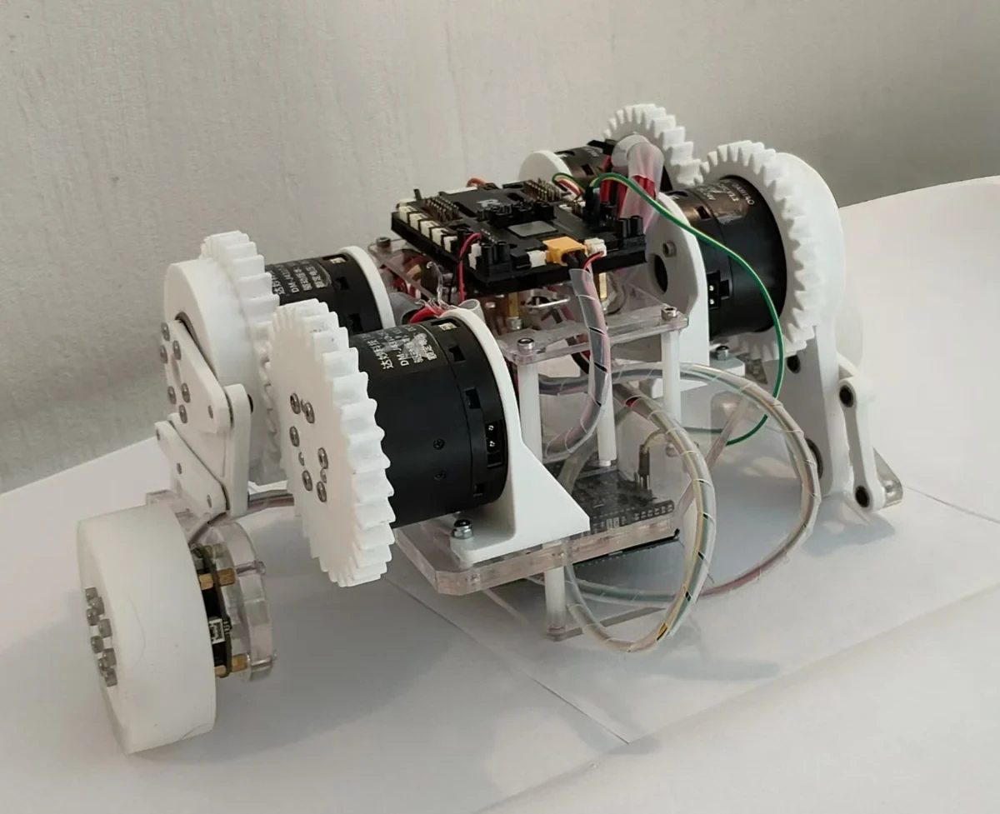
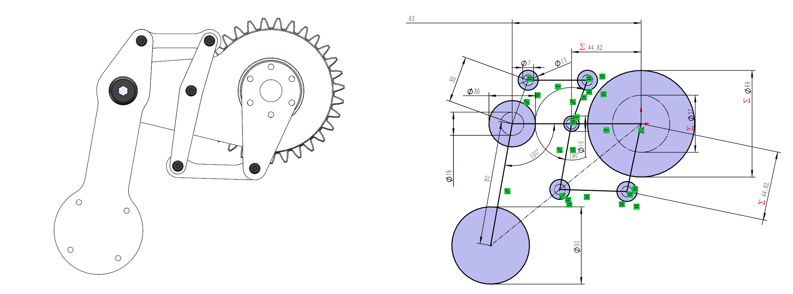
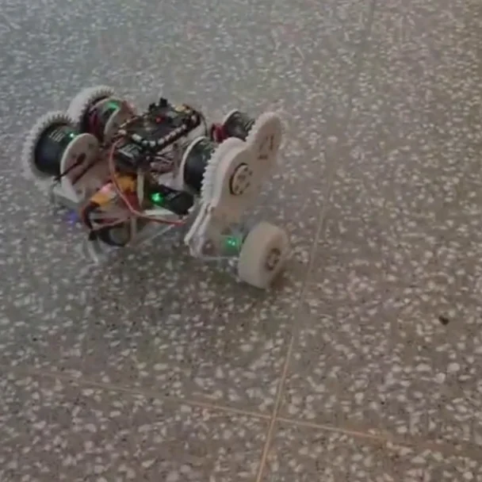
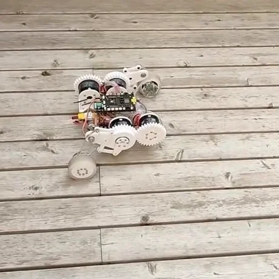
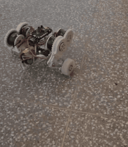
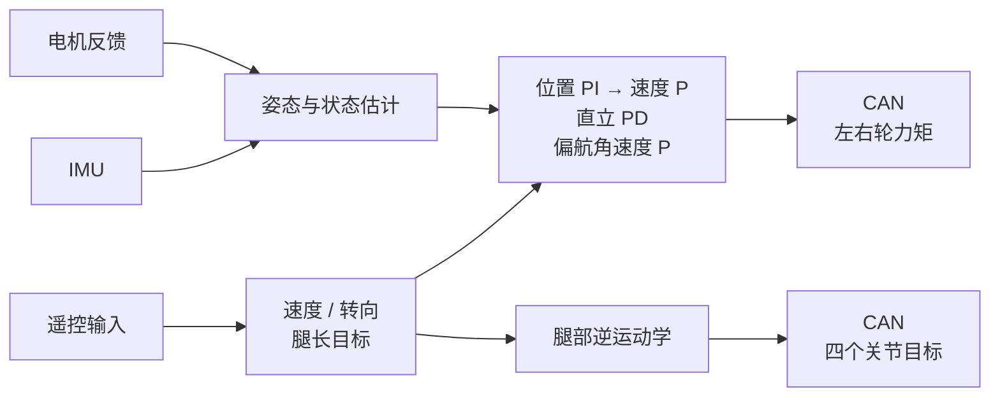

[简体中文](README.md) | [English](README.en.md)

# RoboBachelor

**相似连杆轮腿机构 · STM32 · PID 平衡控制**

<p align="center">
  
</p>
<p align="center"><em>项目实物样机：将轮腿机构、机身板卡与电机线束集成在同一小型底盘上。</em></p>

RoboBachelor（原项目名 **SparkR**）是一台小型两轮腿机器人。轮子承担滚动与平衡，左右两侧的连杆机构调节支撑几何，让机身高度和轮式运动可以分别控制。这个仓库公开机械模型、STM32 固件与配套说明，便于从机构、接线到控制代码一起理解和修改。

本次开源的是 **PID 版本**：位置 PI、速度 P、直立 PD 与偏航角速度 P 构成控制主线，腿部通过逆运动学生成关节目标。

## 腿部设计：用相似连杆实现紧凑布置

每侧用两路关节输入控制等效腿长和腿角，轮毂电机位于腿端。齿轮与相似连杆传递关节运动，使驱动集中在机身侧面，而不用把电机逐级布置到腿的末端。

- **紧凑的侧向布置**：围绕小型机身安排齿轮、连杆和驱动，兼顾腿部运动空间与线束走向。
- **轮与腿分工**：轮端负责滚动，腿部负责改变支撑高度和几何关系。
- **便于控制建模**：以等效腿长、腿角描述轮心位置，再通过逆运动学分配到关节。



*单侧腿的结构视图与几何布局。原生零件、腿部装配和总装入口见[模型导航](mechanical/README.md)。*

**腿部构型思路借鉴了上海交通大学交龙战队的步兵机器人机械开源**，在本项目中围绕小型机身与轮端布置展开。相关官方资料：[交龙战队串联腿步兵机器人机械结构开源](https://bbs.robomaster.com/article/803691)。

## 实物与运动演示

| 室内地面 | 室外木质地面 |
| :---: | :---: |
|  |  |

<p align="center">
  <a href="https://github.com/ppknkn/RoboBachelor/raw/refs/heads/main/media/robobachelor-motion.mp4"></a>
</p>
<p align="center"><a href="https://github.com/ppknkn/RoboBachelor/raw/refs/heads/main/media/robobachelor-motion.mp4">下载完整实物演示（26 秒 MP4，无音轨）</a></p>

以上影像展示项目既有样机的机构与运动。

## 从机械、电气到 PID 控制

| 部分 | 发布工程中的实现 |
| --- | --- |
| 机械 | 左右两条轮腿、每侧两路关节驱动与一个轮端；提供 SolidWorks 零件和装配 |
| 主控 | STM32F4，Keil 工程目标为 STM32F427IIHx |
| 感知 | MPU6500 与 IST8310，结合关节、车轮反馈得到控制所需状态 |
| 执行 | CAN1 连接 4 个 DM4310 关节驱动和 2 个 JC 轮毂驱动 |
| 操作 | 遥控速度、转向和腿长；保留原 STOP 拨杆流程，支持 UART8 参数调试 |



控制代码涵盖起身、平衡、前后行驶、转向、腿长调节，以及摇杆居中时的位置保持。详细参数、符号和调用关系见[控制说明](docs/control.md)；板卡、CAN 与接线依据见[硬件说明](docs/hardware.md)。

## 开始使用

```bash
git clone https://github.com/ppknkn/RoboBachelor.git
cd RoboBachelor
python tools/run_host_tests.py
```

用 Keil 打开 `firmware/MDK-ARM/Imu.uvprojx`，选择 `Imu` 目标并 Rebuild。工具链与附加 ARM GCC 检查步骤见[构建说明](docs/build.md)。

> **首次上电：** 固件会沿原流程请求使能电机，下载和检查时先物理断开动力。新 IMU 后端尚未真机验证；RF209S 的 HOLD 不等于失联停机。请按[上电步骤](docs/bring-up.md)检查。

| 想了解什么 | 入口 |
| --- | --- |
| 看机构、改零件或装配 | [mechanical/](mechanical/README.md) |
| 构建固件与工具链 | [docs/build.md](docs/build.md) |
| 看 PID、运动学与默认参数 | [docs/control.md](docs/control.md) · [firmware/Src/control/](firmware/Src/control/) |
| 核对电机、主控和接线 | [docs/hardware.md](docs/hardware.md) |
| 查看验证记录、IMU 迁移和软件边界 | [验证记录](docs/validation.md) · [IMU 后端](docs/imu-backend.md) · [STOP 与软件边界](docs/safety.md) · [已知问题](docs/known-issues.md) |
| 提问题或贡献修改 | [CONTRIBUTING.md](CONTRIBUTING.md) |

## 许可证与致谢

文件许可、第三方署名与适用范围统一从[许可说明](LICENSE.md)查阅。感谢交龙战队分享机械设计资料，构型参考见上文；项目影像可从[媒体目录](media/README.md)浏览。
